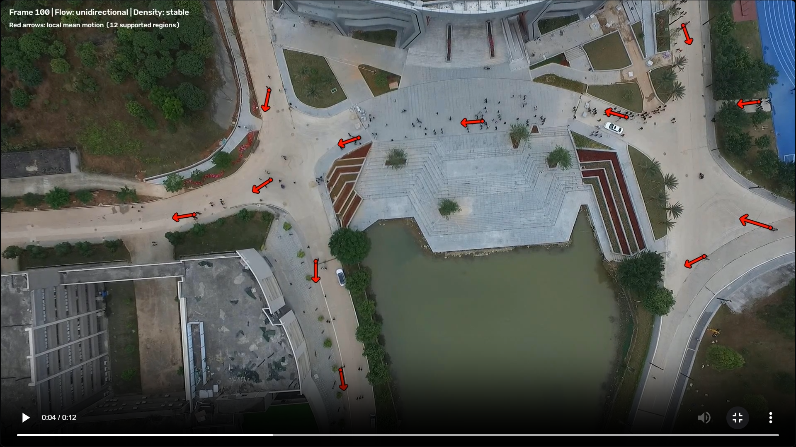
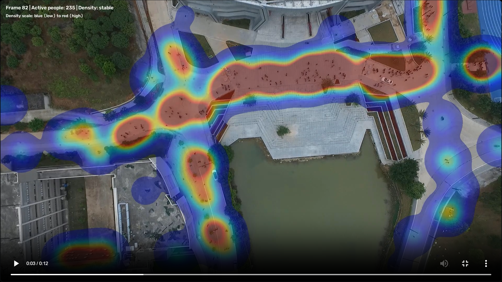
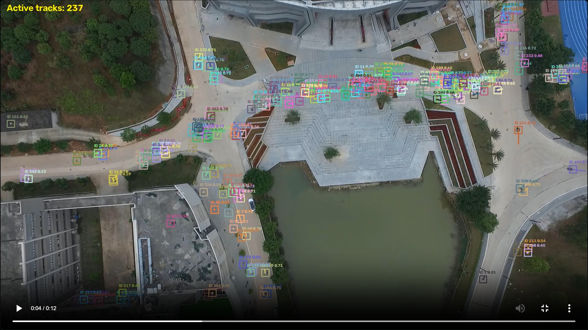
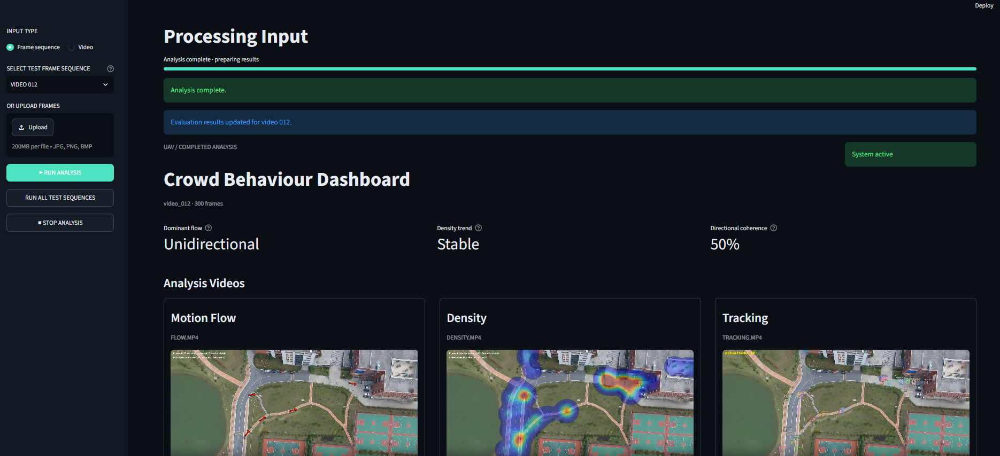
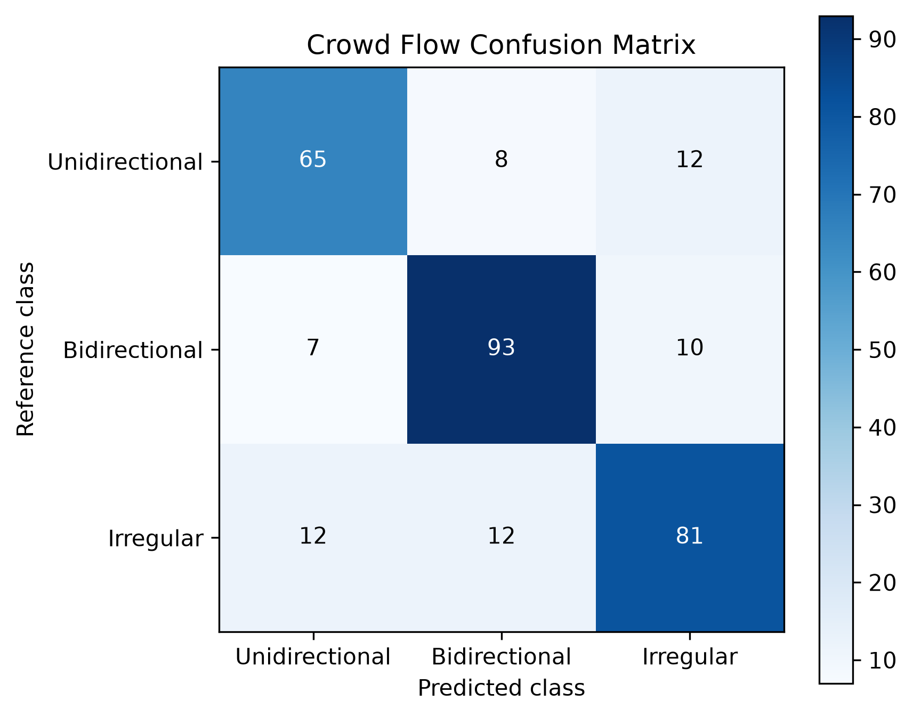
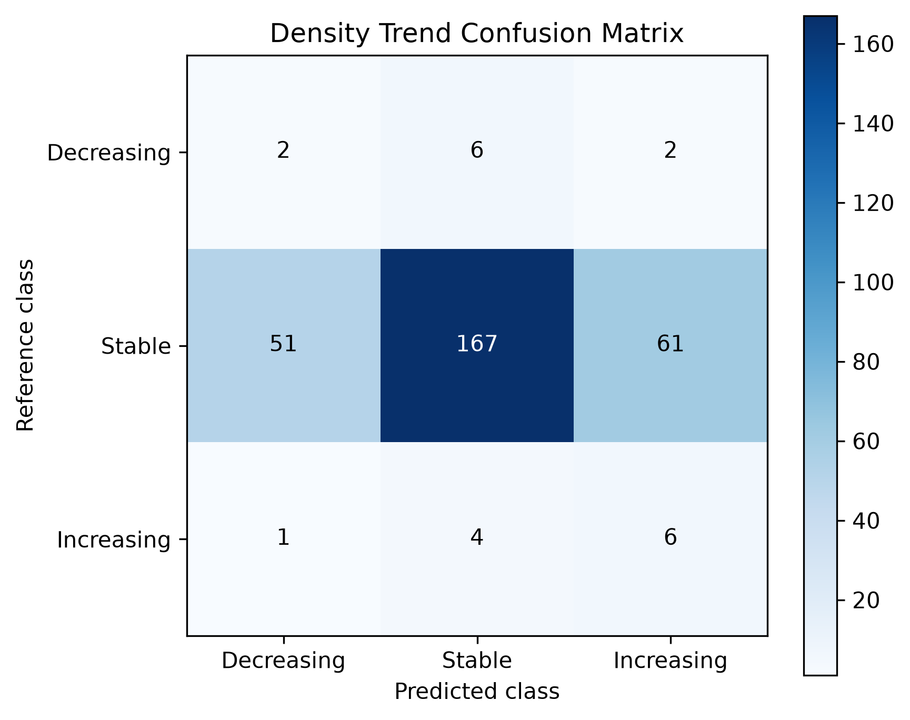
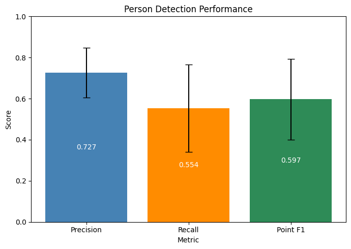

# UAV Crowd Movement & Density Analysis

**MSc Data Science and Artificial Intelligence · Bournemouth University · 2026**  
**Sibel Aybike Can** · Research prototype · Documentation and visual showcase only

## Overview

An end-to-end computer vision research prototype for analysing **pedestrian movement and crowd-density changes in recorded UAV footage**. It combines person detection, multi-object tracking, motion analysis and spatial density visualisation in a local interactive web application.

The project was developed as my MSc dissertation, *Analysis of Crowd Movement Patterns and Density Changes from UAV Videos*.

## Application showcase

### Crowd movement analysis



Tracks are used to estimate movement vectors and classify crowd flow as **unidirectional, bidirectional or irregular**.

### Spatial density heatmap



Heatmaps highlight where detected pedestrians are concentrated within a scene.

### Multi-object tracking



YOLO11s detections are associated across frames with ByteTrack to generate trajectories and movement features.

### Local web dashboard



The Streamlit-based interface presents processed video outputs and analysis summaries.

## Processing pipeline

1. **Input:** Recorded UAV footage from the DroneCrowd dataset.
2. **Person detection:** Fine-tuned YOLO11s model.
3. **Tracking:** ByteTrack associates detections across frames.
4. **Motion analysis:** Bounding-box centre displacements are used to derive pixel-space motion vectors and crowd-flow categories.
5. **Density analysis:** Tracked-person counts support increasing / stable / decreasing trend labels; spatial heatmaps show concentration.
6. **Visualisation:** Local Streamlit interface, annotated videos and structured analysis outputs.

**Technology:** Python · Ultralytics YOLO11s · ByteTrack · OpenCV · PyTorch · Streamlit · Pandas · NumPy

## Evaluation

The final evaluation used **30 DroneCrowd test videos** (9,000 images); flow and trend classifications were evaluated across **300 temporal windows**.

| Component | Metric | Result |
|---|---|---:|
| Person detection | Precision | 0.727 |
| Person detection | Recall | 0.554 |
| Person detection | Point F1-score | 0.597 |
| Multi-object tracking | IDF1 | 0.560 |
| Multi-object tracking | Point-HOTA | 0.457 |
| Crowd-flow classification | Accuracy | 0.797 |
| Crowd-flow classification | Macro F1-score | 0.794 |
| Density-trend classification | Accuracy | 0.583 |
| Density-trend classification | Macro F1-score | 0.315 |

### Crowd-flow classification



### Density-trend classification



### Person detection performance



## Limitations and future work

Detection and tracking errors propagate into the downstream analysis, particularly density-trend classification. Motion is measured in **image pixels**, not calibrated real-world speed. The system processes recorded footage; **real-time performance was not formally evaluated**. This is a research prototype, **not a validated public-safety monitoring system**.

Potential improvements include stronger small-person detection, more robust tracking under occlusion and camera motion, and better temporal density estimation.

## Dataset and attribution

This project uses the **DroneCrowd** dataset, introduced by Wen et al. (2021), for training and evaluation of UAV-based pedestrian detection, tracking and crowd analysis. The original dataset and annotations were created by the DroneCrowd research team; they are **not** my own dataset.

- **Official dataset repository:** [VisDrone / DroneCrowd](https://github.com/VisDrone/DroneCrowd)
- **Original publication:** Wen, L., Du, D., Zhu, P., Hu, Q., Wang, Q., Bo, L., & Lyu, S. (2021). *Detection, Tracking, and Counting Meets Drones in Crowds: A Benchmark*. Proceedings of the IEEE/CVF Conference on Computer Vision and Pattern Recognition (CVPR), 7812–7821. [Read the paper](https://openaccess.thecvf.com/content/CVPR2021/html/Wen_Detection_Tracking_and_Counting_Meets_Drones_in_Crowds_A_Benchmark_CVPR_2021_paper.html).

Visualisations shown in this README are outputs of my own research pipeline applied to DroneCrowd footage. The original imagery and dataset annotations are credited to their creators. The dataset itself is not redistributed here.

### BibTeX citation

```bibtex
@inproceedings{Wen_2021_CVPR,
  author    = {Wen, Longyin and Du, Dawei and Zhu, Pengfei and Hu, Qinghua and Wang, Qilong and Bo, Liefeng and Lyu, Siwei},
  title     = {Detection, Tracking, and Counting Meets Drones in Crowds: A Benchmark},
  booktitle = {Proceedings of the IEEE/CVF Conference on Computer Vision and Pattern Recognition (CVPR)},
  year      = {2021},
  pages     = {7812--7821}
}
```

## Source code availability

**The implementation, trained model weights and underlying dataset are not included in this repository.** This repository is a public-facing project overview containing documentation and selected visual results only.

---
*Individual Master's Project · Bournemouth University · 2026*
